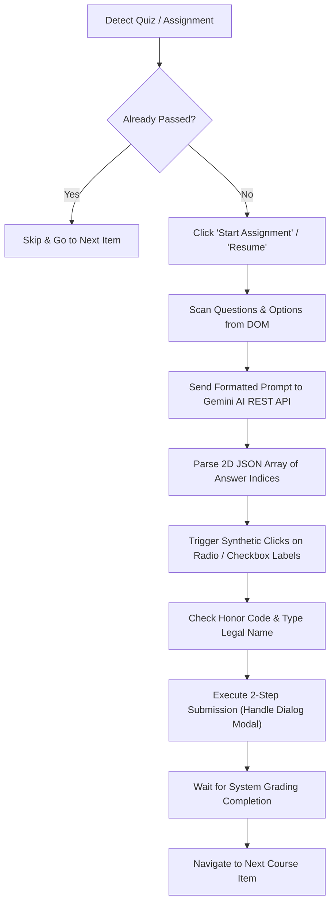

# 🎓 Coursera Full Master Auto DevTool (AI-Powered F12 Console)

[](https://github.com/contactwolfmod/auto_courcera_certificate_devtool)
[](https://ai.google.dev/)
[](https://www.coursera.org)
[](https://developer.mozilla.org/en-US/docs/Web/JavaScript)
[](LICENSE)

An all-in-one browser automation tool for Coursera running directly inside the **Developer Tools Console (F12)**. Integrated with **Google Gemini AI** to automatically solve quizzes/exams, fast-forward video lectures, complete reading assignments, sign the Honor Code, and navigate through course modules autonomously.

---

## 📑 Table of Contents
- [✨ Key Features](#-key-features)
- [🤖 AI Quiz Solving Architecture](#-ai-quiz-solving-architecture)
- [🚀 Quick Start (F12 Console)](#-quick-start-f12-console)
- [⚙️ Configuration](#️-configuration)
- [🛠️ How It Works](#️-how-it-works)
- [⚠️ Security & Disclaimer](#️-security--disclaimer)
- [❓ FAQ & Troubleshooting](#-faq--troubleshooting)

---

## ✨ Key Features

* **🧠 AI-Powered Quiz & Exam Solver:** Automatically parses question groups and options from the DOM, queries **Google Gemini AI** via REST API, and accurately selects Single-Choice, Multiple-Choice, or "Select all that apply" answers.
* **🔁 Dynamic Model Failover & Quota Handling (429):** Rotates between `gemini-3-flash-preview`, `gemini-3.1-flash-lite-preview`, and `gemini-2.5-flash-lite` with fallback endpoints if quota limits are encountered.
* **✍️ Automated Honor Code & Legal Name Signature:** Automatically checks the *"I understand and agree to the Honor Code"* box, fills in your designated Legal Name, and submits the assignment through modal confirmations.
* **⏳ Intelligent Grading Wait:** Actively listens for Coursera's automated grading engine, waits for the grade status (*Passed/Highest grade*), and closes review attempts.
* **🎬 Instant Video Completion:** Fast-forwards video playback directly to the end (`currentTime = duration - 1`), mutes audio to avoid noise, and triggers Coursera's completion tracking.
* **📖 Reading & Widget Auto-Completion:** Smoothly scrolls through reading assignments and clicks `Mark as completed` for articles, plugin widgets, and ungraded labs.
* **🧭 Seamless Module Navigation:** Expands all module menus and iteratively steps through every item in the course syllabus until completion.

---

## 🤖 AI Quiz Solving Architecture



---

## 🚀 Quick Start (F12 Console)

You can run the script in **3 simple steps** without installing any extensions:

### Step 1: Open Your Course on Coursera
1. Log in to [Coursera.org](https://www.coursera.org).
2. Navigate to your enrolled course and open any active lesson (URL format: `/lecture/...`, `/supplement/...`, or `/quiz/...`).
   > *Note: Do not run on the main dashboard (`/my-learning`).*

### Step 2: Open Browser DevTools
* Press **`F12`** (or `Ctrl + Shift + I` on Windows / `Cmd + Option + I` on macOS).
* Select the **Console** tab.

### Step 3: Paste and Execute
1. Copy the full code from **[`coursera_devtool.js`](./coursera_devtool.js)**.
2. Replace `YOUR_GEMINI_API_KEY_HERE` with your actual Google Gemini API Key.
3. Paste into the Console and hit **Enter**.
4. The tool will start running immediately, logging each step to the console.

---

## ⚙️ Configuration

At the top of [`coursera_devtool.js`](./coursera_devtool.js), configure your credentials and details:

```javascript
// 1. Google Gemini API Key (Get free key from https://aistudio.google.com/)
const API_KEY = "YOUR_GEMINI_API_KEY_HERE";

// 2. Your Full Legal Name (Used for Coursera certificate verification & Honor Code submission)
const LEGAL_NAME = "Your Legal Name";

// 3. Preferred Gemini models in rotation order
const MODELS = [
    "gemini-3-flash-preview",
    "gemini-3.1-flash-lite-preview",
    "gemini-2.5-flash-lite"
];
```

---

## 🛠️ How It Works

1. **SPA Route Detection:** Continuously monitors `window.location.pathname` to identify the resource type:
   - `/lecture/`: HTML5 Video player.
   - `/supplement/`: Reading articles.
   - `/ungradedWidget/` / `/ungradedLti/`: Interactive widgets and labs.
   - `/quiz/` / `/exam/` / `/assignment-submission/`: Assessments.
2. **Synthetic Event Dispatching:** Dispatches real DOM `MouseEvent` (`mousedown`, `mouseup`, `click` with `bubbles: true`) to ensure React event listeners register human-like interactions.
3. **Structured AI Prompting:** Sends formatted multiple-choice questions to Gemini with strict temperature (`0.1`) requesting a pure 2D JSON array of index selections, minimizing hallucinations.

---

## ⚠️ Security & Disclaimer

> [!WARNING]
> **API Key Safety:**
> Never commit or push your personal `API_KEY` to public repositories. GitHub Secret Scanning and Google Cloud will automatically revoke leaked keys within minutes.

> [!CAUTION]
> **Terms of Service & Honor Code Notice:**
> This repository is developed **strictly for educational and research purposes** to explore browser automation, DOM reverse engineering, and LLM API integrations. 
> Using automated scripts to bypass assessments or artificially obtain certificates violates Coursera's Honor Code and Terms of Service. The maintainers assume no liability for account suspensions, course disqualifications, or revoked certificates.

---

## ❓ FAQ & Troubleshooting

<details>
<summary><b>1. "API Quota Exceeded (429)" error?</b></summary>
The script automatically rotates between 3 different Gemini models. If you reach your free tier limits on Google AI Studio, wait a few minutes or provide an API Key from a paid project.
</details>

<details>
<summary><b>2. Script stopped at a Quiz without submitting?</b></summary>
Check if Coursera presented a non-standard questionnaire, peer-review assignment, or verification selfie. Complete that specific step manually, then re-run the script.
</details>

<details>
<summary><b>3. How do I stop the script?</b></summary>
Simply reload the browser tab (Press <code>F5</code> or <code>Ctrl + R</code>).
</details>

---

## 👨‍💻 Author & Contributions

* **Repository:** [https://github.com/contactwolfmod/auto_courcera_certificate_devtool](https://github.com/contactwolfmod/auto_courcera_certificate_devtool)
* Contributions, bug reports, and pull requests are welcome!
