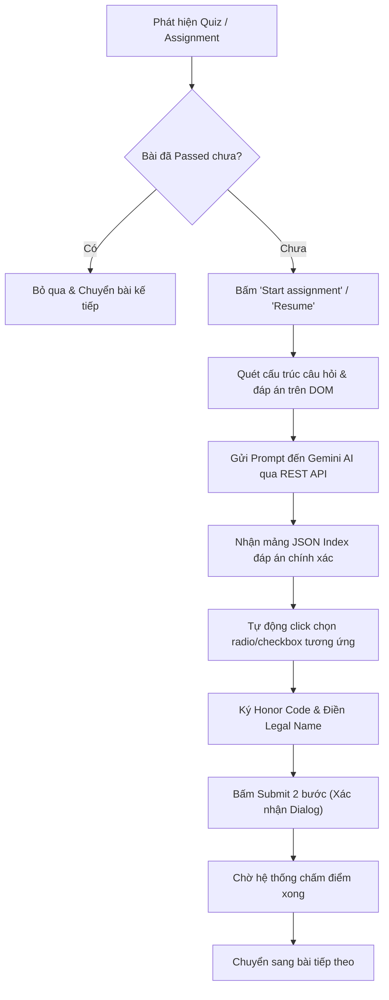

# 🎓 Coursera Full Master Auto DevTool (AI-Powered F12 Console)

[](https://github.com/contactwolfmod/auto_courcera_certificate_devtool)
[](https://ai.google.dev/)
[](https://www.coursera.org)
[](https://developer.mozilla.org/en-US/docs/Web/JavaScript)

Công cụ tự động hóa toàn diện cho Coursera chạy trực tiếp trên **Console F12**, tích hợp **Google Gemini AI** để tự động giải bài kiểm tra (Quiz/Practice/Exam), tua video, đánh dấu bài đọc và vượt qua khóa học một cách liền mạch.

---

## 📑 Mục lục
- [✨ Tính năng đột phá](#-tính-năng-đột-phá)
- [🤖 Cơ chế AI giải đề (Quiz Automation)](#-cơ-chế-ai-giải-đề-quiz-automation)
- [🚀 Hướng dẫn sử dụng nhanh (F12 Console)](#-hướng-dẫn-sử-dụng-nhanh-f12-console)
- [📤 Hướng dẫn khởi tạo & Push lên GitHub](#-hướng-dẫn-khởi-tạo--push-lên-github)
- [⚙️ Cấu hình API Key & Legal Name](#️-cấu-hình-api-key--legal-name)
- [⚠️ Cảnh báo bảo mật & Bản quyền API Key](#️-cảnh-báo-bảo-mật--bản-quyền-api-key)

---

## ✨ Tính năng đột phá

* **🧠 Tích hợp Google Gemini AI:** Tự động gửi câu hỏi trắc nghiệm (Single/Multiple Choice, Select all that apply) đến các mô hình `gemini-3-flash-preview`, `gemini-3.1-flash-lite-preview`, `gemini-2.5-flash-lite` để nhận đáp án chính xác.
* **🔁 Tự động xoay vòng Model & Xử lý Quota (429):** Tự động chuyển đổi giữa các model và endpoint khi bị quá tải hạn mức.
* **✍️ Tự động ký Cam kết danh dự (Honor Code):** Tự động tích ô "I understand and agree", điền tên pháp lý (Legal Name) và nộp bài (Submit) kèm xác nhận hộp thoại.
* **⏳ Chờ chấm điểm thông minh (Auto Grading Wait):** Lắng nghe trạng thái nộp bài và chờ kết quả chấm điểm trước khi chuyển sang bài tiếp theo.
* **🎬 Tua nhanh Video & Hoàn thành:** Tua trực tiếp video đến cuối (`duration - 1`), tắt tiếng và xác nhận hoàn thành bài giảng.
* **📖 Tự động hoàn thành Reading & Plugin/Lab:** Bấm `Mark as completed` cho các bài đọc bổ trợ và widget.
* **🧭 Điều hướng menu toàn diện:** Tự động mở rộng danh sách module và duyệt qua toàn bộ cây bài học tuần tự.

---

## 🤖 Cơ chế AI giải đề (Quiz Automation)



---

## 🚀 Hướng dẫn sử dụng nhanh (F12 Console)

1. Đăng nhập vào [Coursera](https://www.coursera.org) và mở khóa học cần hoàn thành.
2. Đảm bảo bạn đang ở **trang bài học cụ thể** (URL dạng `/lecture/...` hoặc `/supplement/...`, không chạy ở trang chủ `/my-learning`).
3. Nhấn **`F12`** (hoặc `Ctrl + Shift + I` trên Windows, `Cmd + Option + I` trên macOS).
4. Chọn tab **Console**.
5. Mở tệp **[`coursera_devtool.js`](./coursera_devtool.js)**, sao chép toàn bộ mã nguồn.
6. Dán vào Console và nhấn **Enter**.
7. Script sẽ tự động chạy liên tục qua tất cả các bài học cho đến hết khóa học.

---

## ⚙️ Cấu hình API Key & Legal Name

Ở đầu tệp [`coursera_devtool.js`](./coursera_devtool.js), bạn có thể tùy chỉnh:

```javascript
const API_KEY = "YOUR_GEMINI_API_KEY_HERE"; // Thay bằng Gemini API Key của bạn
const LEGAL_NAME = "WM"; // Họ và tên của bạn dùng để ký chứng chỉ
```

---

## 📤 Hướng dẫn khởi tạo & Push lên GitHub

Dự án hiện tại được lưu cục bộ trên máy tính của bạn. Để đưa dự án lên GitHub `https://github.com/contactwolfmod/auto_courcera_certificate_devtool`, bạn hãy thực hiện theo các bước sau trong terminal:

### 1. Khởi tạo Git và liên kết Remote:
```bash
cd "C:\Users\MSI 15\auto_courcera_certificate_devtool"
git init
git add .
git commit -m "feat: initial release of Coursera Full Master Auto DevTool with Gemini AI"
git branch -M main
git remote add origin https://github.com/contactwolfmod/auto_courcera_certificate_devtool.git
```

### 2. Đẩy mã nguồn lên GitHub (Push):
```bash
git push -u origin main
```
*(Nếu repository trên GitHub yêu cầu xác thực, hãy nhập GitHub Personal Access Token của bạn).*

---

## ⚠️ Cảnh báo bảo mật & Bản quyền API Key

> [!WARNING]
> **Lưu ý bảo mật về API Key:**
> Trong file `coursera_devtool.js` hiện có chứa trực tiếp mã `API_KEY`. Nếu bạn đẩy mã nguồn này lên một kho lưu trữ **Công khai (Public Repository)** trên GitHub:
> - Các hệ thống quét tự động (Secret Scanner) của Google/GitHub sẽ phát hiện và có thể **vô hiệu hóa (revoke)** key của bạn ngay lập tức.
> - **Khuyến nghị:** Hãy đặt kho lưu trữ ở chế độ **Riêng tư (Private)**, hoặc xóa key trước khi push công khai và hướng dẫn người dùng tự điền API Key cá nhân của họ.
